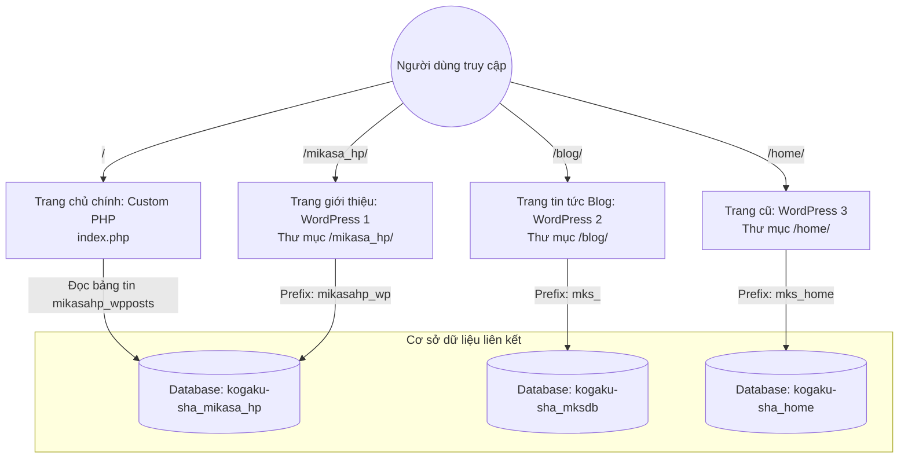

# Dự án 三笠塾 (Mikasa Juku) - Workspace Know-how & Rules

Tài liệu này đóng vai trò là **Know-how & Rulebook** chuẩn cho trợ lý AI (Agent) khi làm việc trong workspace này. Mọi Agent tham gia phiên làm việc đều tự động đọc và tuân thủ các quy tắc dưới đây mà không cần phải quét hoặc phân tích lại toàn bộ dự án từ đầu.

---

## 1. Bản đồ kiến trúc hệ thống (System Architecture)

Dự án này là mô hình lai (**Hybrid Architecture**) kết hợp giữa **PHP thuần (Custom PHP)** ở thư mục gốc và **3 phân hệ WordPress độc lập** nằm trong các thư mục con:



### Chi tiết các phân hệ:

| Phân hệ | Đường dẫn | Công nghệ & Phiên bản | Database liên kết | Mục đích |
| :--- | :--- | :--- | :--- | :--- |
| **Trang chủ gốc** | `/index.php` | Custom PHP thuần | `kogaku-sha_mikasa_hp` | Giao diện landing page chính, hiển thị slide, banner và 20 tin mới nhất |
| **Giới thiệu** | `/mikasa_hp/` | WordPress `7.2-alpha` (6.7+ trunk) | `kogaku-sha_mikasa_hp` | Trang giới thiệu trường, bài viết của thầy cô, tin tức tổng hợp |
| **Blog tin tức** | `/blog/` | WordPress `7.2-alpha` (6.7+ trunk) | `kogaku-sha_mksdb` | Blog "三笠塾便り" (Tin tức & sinh hoạt thường nhật) |
| **Home cũ** | `/home/` | WordPress `5.7.13` (Legacy) | `kogaku-sha_home` | Trang lưu trữ cũ, không có theme ngoài hoạt động |
| **Tài nguyên tĩnh** | `/files/`, `/images/`, `/styles/` | HTML, CSS, JS, PDF | Không | Chứa biểu mẫu, bài tập, ấn phẩm PDF "Les Mikasa" |
| **CGI Counter** | `/npc/` | Perl CGI (`npc.cgi`) | Không | Bộ đếm lượt xem (Web counter) cổ điển |

---

## 2. Quy tắc môi trường & Kết nối Database (Local vs Production)

Mỗi phân hệ đều sử dụng cơ chế **Auto-detect Environment** để chuyển đổi giữa Local và Production mà không cần đổi code thủ công.

### A. Nhận diện môi trường
```php
$is_local = (isset($_SERVER['HTTP_HOST']) && in_array($_SERVER['HTTP_HOST'], ['localhost', 'mikasajyuku.test'])) 
            || (isset($_SERVER['REMOTE_ADDR']) && in_array($_SERVER['REMOTE_ADDR'], ['127.0.0.1', '::1']))
            || (php_sapi_name() === 'cli');
```

### B. Bảng thông số kết nối:
* **Local (Laragon):**
  - Host: `127.0.0.1` | User: `root` | Password: `""` (để trống)
  - 3 Database tương ứng: `kogaku-sha_mikasa_hp`, `kogaku-sha_mksdb`, `kogaku-sha_home`.
  - Base URL Local: `http://localhost/mikasajyuku/` (hoặc `http://mikasajyuku.test/`).
* **Production (Sakura Rental Server):**
  - Host: `mysql633.db.sakura.ne.jp` (cho main & blog) và `mysql57.kogaku-sha.sakura.ne.jp` (cho home cũ).
  - Web Server Path: `/home/kogaku-sha/www/mikasajyuku/`.
  - URL: `https://mikasajyuku.jp/`.

> [!IMPORTANT]
> **Quy tắc tuyệt đối:** Không được xoá logic kiểm tra `$is_local` hoặc ghi đè thông tin kết nối production lên local hay ngược lại.

---

## 3. Cơ chế hoạt động của Bảng tin (掲示板) trang chủ

- Trang chủ gốc (`/index.php`) liên kết với phân hệ WordPress 1 thông qua file [`controller/db_connection.php`](file:///c:/laragon/www/mikasajyuku/controller/db_connection.php).
- Tại đây, trang chủ thực hiện câu lệnh SQL:
  ```sql
  SELECT * FROM mikasahp_wpposts 
  WHERE post_type='post' AND post_status='publish' 
  ORDER BY post_date DESC LIMIT 20;
  ```
- **Ý nghĩa:** Khi quản trị viên đăng bài viết mới trên trang `/mikasa_hp/`, bài viết đó sẽ ngay lập tức tự động hiển thị ở phần **Bảng tin** tại trang chủ ngoài `/`.

---

## 4. Triển khai CI/CD (GitHub Actions)

- Quy trình triển khai được định nghĩa tại [`.github/workflows/deploy.yml`](file:///c:/laragon/www/mikasajyuku/.github/workflows/deploy.yml).
- **Kích hoạt:** Tự động chạy khi có commit push lên nhánh `main`.
- **Cơ chế:** Đồng bộ SFTP gia số (Delta sync) lên Sakura Rental Server qua SSH Key.
- **Danh sách loại trừ (Excludes):**
  ```text
  .git/ .github/ node_modules/ wp-content/uploads/ wp-content/cache/ wp-content/backups/ README.md screenshot.png
  ```
- **Lưu ý:** Thư mục `wp-content/uploads/` trên production không bị ghi đè hay xóa bởi GitHub Actions.

---

## 5. Quy chuẩn viết mã & Tương thích PHP 8.2+ (Coding Rules)

Dự án đang trong lộ trình nâng cấp lên **PHP 8.2.35**. Mọi đoạn mã mới hoặc chỉnh sửa phải tuân theo các quy định sau:

1. **Xử lý MySQLi trên PHP 8.1 / 8.2:**
   - Kể từ PHP 8.1, `mysqli` tự động ném `mysqli_sql_exception` khi có lỗi.
   - Luôn sử dụng khối `try ... catch (mysqli_sql_exception $e)` khi tạo kết nối hoặc thực hiện truy vấn quan trọng.
   - Không sử dụng `or die(...)` sau `new mysqli(...)`.
   - Không sử dụng toán tử dập lỗi `@` để che giấu ngoại lệ kết nối database.

2. **Null-Safety cho các hàm chuỗi built-in:**
   - PHP 8.1+ nghiêm cấm truyền `null` vào đối số của các hàm: `explode()`, `strlen()`, `substr()`, `trim()`, v.v.
   - Luôn ép kiểu `(string)` hoặc kiểm tra `!empty()` trước khi truyền dữ liệu từ database vào hàm chuỗi.

3. **Kiểm tra kiểu dữ liệu trả về trước khi đọc thuộc tính:**
   - Đối với kết quả query `$result = $conn->query(...)`: Luôn kiểm tra `if ($result && $result->num_rows > 0)` để tránh lỗi fatal `Cannot access property on bool` khi query thất bại.

4. **WordPress Core & Theme:**
   - Phân hệ `/mikasa_hp/` sử dụng theme con `author-landing-page` kế thừa từ `book-landing-page`. Không sửa đổi trực tiếp vào code core của WordPress mà sử dụng child theme hoặc hooks/filters.
   - Không chỉnh sửa file `wp-config.php` thủ công trừ khi cập nhật cấu hình bảo mật hoặc hằng số hệ thống.

---

## 6. Các script hỗ trợ & gỡ lỗi (Tools & Debugging)

- File kiểm tra tài khoản quản trị production: [`mikasa_hp/check_prod_users.php`](file:///c:/laragon/www/mikasajyuku/mikasa_hp/check_prod_users.php) (yêu cầu tham số bảo mật `?secret=mikasa2026`).
- File nhật ký gỡ lỗi WordPress: [`mikasa_hp/wp-content/debug.log`](file:///c:/laragon/www/mikasajyuku/mikasa_hp/wp-content/debug.log).
